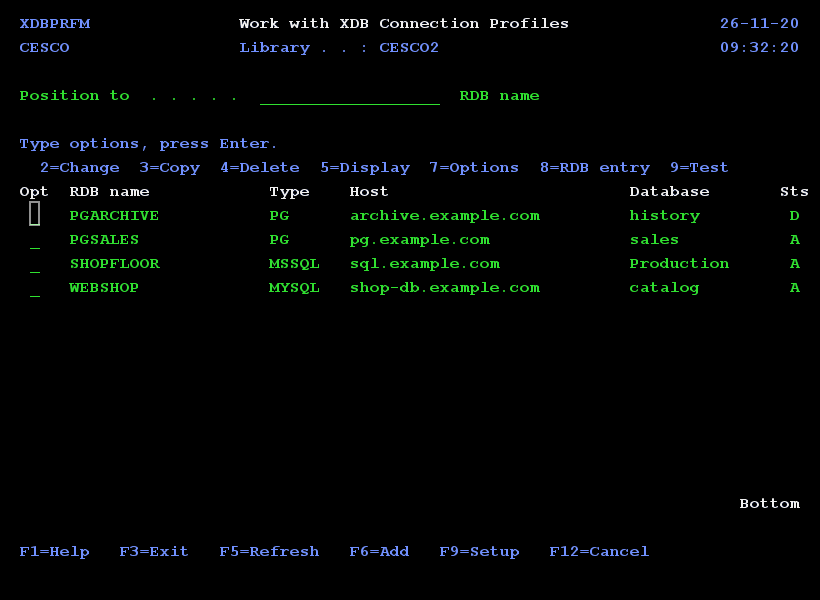
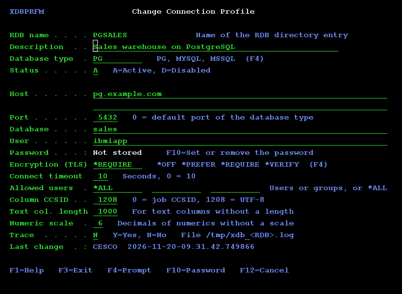
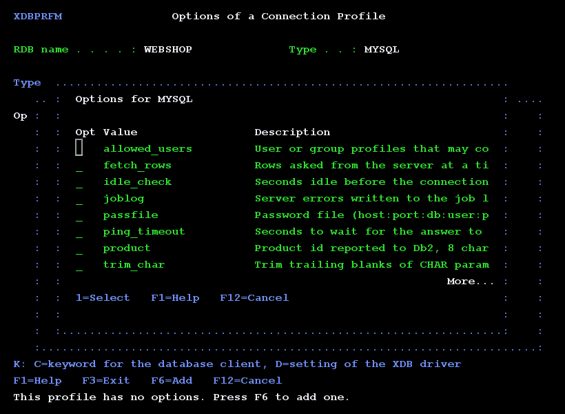
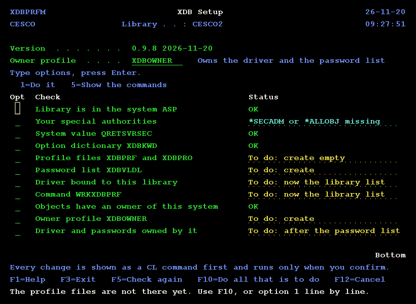

# XDBARDDRV - external databases through CONNECT TO on IBM i

XDBARDDRV lets SQL on IBM i work with databases that are not Db2. After
`CONNECT TO name`, the statements of interactive SQL (STRSQL) or of a program
with embedded SQL run on a **PostgreSQL**, **MySQL** or **Microsoft SQL
Server** database. It is a Db2 application requester driver (ARD) written in
ILE C and RPG: native objects only, no Java, no PASE, no ODBC.

XDBARDDRV is the name of the software. Its objects carry the short prefix
XDB (service program `XDB`, command `WRKXDBPRF`), and so do the files of the
package.

**Status: experimental.** The software is offered as it is, without warranty
of any kind and without an obligation to support it. Try it on test data
before you rely on it. See "Licence and notices" at the end.

Connection profiles (where each database is, how to sign on, how data is
handed to Db2) are kept in native files and maintained with the command
`WRKXDBPRF`, which is also the installer.

## How it looks

Everything is done on 5250 displays. These were taken on PUB400.COM, in the
library a package had just been built in, with made-up profiles:

| The profiles, one for each database that `CONNECT TO` reaches | A profile: where the database is, and how its data is handed to Db2 |
|:---|:---|
|  |  |
| **Options beyond the fields come from a dictionary, prompted with F4** | **The setup: what is in order in this library, and what is to do** |
|  |  |

F1 shows the help of the field, the column or the line of keys the cursor
is in ([the help of a field](https://raw.githubusercontent.com/cesco030/xdbarddrv/main/doc/img/wrkxdbprf-help.png)), and the setup shows
every change as CL commands before it runs them
([such a window](https://raw.githubusercontent.com/cesco030/xdbarddrv/main/doc/img/wrkxdbprf-setup-commands.png)).

## What is in the package

| File | Content |
|---|---|
| `xdb-<version>-objects.savf` | the objects, to restore into a library of your choice |
| `xdb-<version>-sources.savf` | the sources (stream files), to restore into the IFS |
| `WRKXDBPRF-help.html` | the help text of the command, as a page to read |
| `README.md` | this file |
| `LICENSE` | the licence of XDBARDDRV (MIT) |
| `THIRD-PARTY-NOTICES.txt` | the notices of the PostgreSQL code in the package; it has to stay with every copy |

Objects in the first save file:

| Object | Type | What |
|---|---|---|
| XDB | *SRVPGM | the driver (PostgreSQL, MySQL, SQL Server) |
| LIBPQ | *SRVPGM | PostgreSQL client library (ILE port of libpq) |
| XDBARD | *PGM | program Db2 calls (named in the RDB directory entries) |
| XDBCMT | *PGM | commitment control exit program |
| XDBPRFM | *PGM | profile maintenance and setup (command WRKXDBPRF) |
| XDBPRFT | *PGM | connection test |
| WRKXDBPRF | *CMD, *PNLGRP | the command and its help |
| XDBPRFD | *FILE | display file |
| XDBKWD | *FILE | dictionary of the profile options |
| XDBPRFMDL, XDBPROMDL | *FILE | models of the profile files |
| XDBVER | *DTAARA | version of the package |
| XDBLICENSE | *FILE | the two texts above as source members LICENSE and NOTICES, so that they travel with the objects |

The package holds **no profiles and no passwords**. The profile files
XDBPRF and XDBPRO and the password list XDBVLDL are created by the setup
from the models, so restoring a newer package over an installed one cannot
overwrite them.

## Requirements

- IBM i 7.5 (the objects of this package are built for that release).
- A library in the system ASP or a basic user ASP, not an independent ASP.
- System value QRETSVRSEC = 1 to store passwords in the profiles. Without
  it the databases can be used with a password given on CONNECT or with a
  password file.
- For the setup steps about owners: *SECADM and *ALLOBJ special
  authority. The setup shows the commands, so a security officer can run
  them.

## Where the packages come from

The published packages are built on PUB400.COM, a public IBM i system, from
the sources of this repository: a clone of the commit that carries the
version tag, compiled there by `build/dist.sh` in library CESCO2 under the
profile CESCO. Nothing in them comes from another place.

- The objects save file of every version is on the
  [Releases](https://github.com/cesco030/xdbarddrv/releases) page of the
  repository; the newest is always at
  [releases/latest](https://github.com/cesco030/xdbarddrv/releases/latest).
- Everything a build produced is in the branch `packages`, one folder for
  each version: the objects save file again, the sources save file, this
  README, the help of the command as a page, the licence texts, the log of
  the build (`dist.log`) and `SHA256SUMS`.

**Versions 0.9.7 and 0.9.8 were withdrawn**: with them every query on a
Microsoft SQL Server fails (SQLSTATE 07008). Their save files were taken
off the Releases page and out of the branch; 0.9.9 replaces them.

Two things in this README follow from that: the restore commands name
`SAVLIB(CESCO2)`, and after the first restore the setup has the line
*Objects have an owner of this system* to do (see "Installing").

## Installing

Download `xdb-<version>-objects.savf` from the
[latest release](https://github.com/cesco030/xdbarddrv/releases/latest),
upload it to the IFS in binary, then:

```
CRTLIB LIB(XDB)
CRTSAVF FILE(QGPL/XDBSAVF)
CPYFRMSTMF FROMSTMF('/path/xdb-<version>-objects.savf')
           TOMBR('/QSYS.LIB/QGPL.LIB/XDBSAVF.FILE') MBROPT(*REPLACE) CVTDTA(*NONE)
RSTOBJ OBJ(*ALL) SAVLIB(CESCO2) DEV(*SAVF) SAVF(QGPL/XDBSAVF) RSTLIB(XDB)
CALL PGM(XDB/XDBPRFM)
```

Any library name can be used instead of XDB. The program does not ask for
the library: it works on the one it was started from, and the library does
not have to be in the library list. `XDBPRFM` is the program behind the
command `WRKXDBPRF`. Until the setup has run, the command itself finds its
program through the library list, so `XDB/WRKXDBPRF` works right after the
restore only with `ADDLIBLE LIB(XDB)` before it; after the setup it works
from anywhere.

Because the profile files are not there yet, the **Setup** display comes
first. It lists what is in order and what is to do:

| Line | What the setup does |
|---|---|
| Library is in the system ASP | check only |
| Your special authorities | check only |
| System value QRETSVRSEC | check only; shows the command, never runs it |
| Option dictionary XDBKWD | check only |
| Profile files XDBPRF and XDBPRO | creates them empty from the models |
| Password list XDBVLDL | creates it with public authority *EXCLUDE |
| Driver bound to this library | binds the programs to the service programs of this library, so the driver works in every job whatever its library list is |
| Command WRKXDBPRF | points the command and its help to this library |
| Objects have an owner of this system | gives the objects that the restore left with the default owner QDFTOWN to QPGMR (see below) |
| Owner profile | creates profile XDBOWNER (or the name you type): no password, no special authority |
| Driver and passwords owned by it | gives the driver and the password list to that profile and lets the driver adopt its authority to read the passwords |

`F10` goes through the lines that are to do. **Every step first shows the
CL commands it will run and waits for Enter**; `F12` skips a step. Each
command is written to the job log before it runs. Option `5` shows the
commands of a line without running anything. Nothing outside the library is
changed except the owner profile; system values are never changed.

A restore gives an object to the default owner QDFTOWN when the profile
that owned it where it was saved does not exist on your system. That is the
case of a package built by a profile of its own, and the line *Objects have
an owner of this system* is then to do: it gives each of those objects to
QPGMR. A package built by QPGMR arrives with that owner and the line is in
order from the start.

After the setup the library is no longer needed in the library list.

## First steps

1. `WRKXDBPRF`, `F6`: add a profile (RDB name, database type, host,
   database, user), Enter, then `F10` to store the password.
2. Option `8` adds the RDB directory entry of the same name, with the
   description of the profile as its text (what `WRKRDBDIRE` lists).
3. Option `9` tests the connection.
4. In STRSQL: `CONNECT TO name`, then SQL in the dialect of the server.
   `COMMIT` before `DISCONNECT name`; `CONNECT RESET` returns to Db2.
5. `F1` on every display shows the help for the field or the part of the
   display the cursor is in; `F2` in the help shows the help of the whole
   display. `F1` on the command itself has the whole manual: every field,
   option and key, the rules for programs with embedded SQL, and what to do
   when something fails.

Two things that are met on the first day:

- **SQL5028 at the first statement.** The connections work only under
  commitment control: Db2 lets no statement through to a database that is
  not Db2 for i from a session or a program that runs with commitment
  control *NONE (`COMMIT(*NONE) valid only if relational database ... is
  DB2 for IBM i`, SQLSTATE 560C4). The CONNECT itself works. In STRSQL:
  `STRSQL COMMIT(*CHG)`, or F13 and "Change session attributes"; a program
  is created with `COMMIT(*CHG)`.
- **The server does not know the database, though it is there.**
  PostgreSQL turns a name that is written without quotation marks into
  lower case: `CREATE DATABASE SALES` makes the database `sales`, and the
  profile has to say `sales`. The profile keeps upper and lower case as
  typed.

The help of the displays is found through the library list. So that it
works from any job, `XDBPRFM` puts its library at the end of the library
list while it runs and takes it out again when it ends; a library that is
in the list already is left where it is.

## Who may use a profile

Every user of the system can connect with a profile unless the profile names
its **allowed users**: up to three user profiles or group profiles on the
profile display, more with option `allowed_users`. The driver then lets a
job connect only when its user is named, or has a named profile as group
profile or supplemental group. Other users get SQLCODE -30082, and the job
log says why.

## Large values: from and to stream files

Db2 hands a driver at most 32 K per value and no large object at all, so a
document of megabytes cannot pass through a host variable. It can pass
beside Db2: the statement names a stream file, and the driver, which runs
in the job of the program, moves the value between that file and the
server, on the connection and in the unit of work of the statement. Four
functions in the statement text ask for it, on PostgreSQL, MySQL / MariaDB
and SQL Server connections alike (the examples are written for PostgreSQL;
the rest of a statement is in the language of its server, so the name of a
file is put together with `CONCAT(...)` on MySQL and with `+` on SQL
Server):

    -- a file becomes a value
    INSERT INTO doc (id, body) VALUES(?, GET_BLOB_FROM_FILE(?))
    UPDATE doc SET note = GET_CLOB_FROM_FILE('/home/me/note.txt') WHERE id = 7

    -- a value becomes a file: one per row, named by the row
    SELECT id, PUT_BLOB_TO_FILE(body, '/home/me/doc' || id || '.pdf')
      FROM doc WHERE year = 2026
    SELECT PUT_CLOB_TO_FILE(note, ?, 16, 1252) FROM doc WHERE id = ?

| Function | What it does |
|---|---|
| `GET_BLOB_FROM_FILE(name)` | The bytes of a stream file as a value. In a statement that returns no rows (INSERT, UPDATE, CALL). Name and meaning are those of the Db2 for i function; `name` is a string or a parameter marker. |
| `GET_CLOB_FROM_FILE(name)` | The same for text, converted from the CCSID of the file. |
| `PUT_BLOB_TO_FILE(value, name [, option])` | A column of the result of a query: every row fetched writes its value to the file named by the second argument, any expression of the server. The column is the number of bytes the file grew by (BIGINT), or null when the value is null - then no file is touched. A new file has CCSID 65535. |
| `PUT_CLOB_TO_FILE(value, name [, option [, ccsid]])` | The same for text. `ccsid` is the CCSID of a new file, 1208 (UTF-8) by default. A file that exists keeps its CCSID: text that replaces its content or is appended is converted to it. |

`option` has the values of an SQL file reference variable: `8` the file must
not exist, `16` create or replace (default), `32` create or append.

In an RPG program (created with `RDB(*LOCAL) COMMIT(*CHG)`):

    dcl-s stm varchar(500);
    dcl-s id int(10);
    dcl-s path varchar(255);
    dcl-s bytes int(20);
    dcl-s isNull int(5);

    exec sql connect to MYPG;
    // a file into a column
    stm = 'insert into doc (id, body) values(?, GET_BLOB_FROM_FILE(?))';
    exec sql prepare s1 from :stm;
    id = 4711;
    path = '/home/me/invoice4711.pdf';
    exec sql execute s1 using :id, :path;
    // a column into a file
    stm = 'select PUT_BLOB_TO_FILE(body, ?) from doc where id = ?';
    exec sql prepare q1 from :stm;
    exec sql declare c1 cursor for q1;
    path = '/home/me/copy4711.pdf';
    exec sql open c1 using :path, :id;
    exec sql fetch c1 into :bytes :isNull;
    exec sql close c1;
    exec sql commit;

What to know:

- The functions are found in the statement text, so the statement must be
  dynamic (PREPARE and EXECUTE, a cursor on a prepared statement, or typed
  in STRSQL). `PUT_...` must be a column of the outermost SELECT, with no
  `*` in front of it, and is fetched through a cursor.
- Files are opened as the user of the job, with that user's authority: the
  driver gives nobody access to a file he does not have. Others can read a
  new file, its owner can change it. The name of a file to write comes
  from the server with the row: build it from values you trust.
- The job never holds more than a piece of a value, whatever its size; the
  limit is the one of the server:

  | Server | How a value travels | Limit |
  |---|---|---|
  | PostgreSQL | Up to option `lob_direct` (4 MB) in one piece. A larger one passes through a large object of the server, which the driver writes or reads in pieces of 1 MB and removes again in the same unit of work (PostgreSQL 9.4 or later; a server that only allows reading delivers values up to `lob_direct`). | 1 GB |
  | MySQL, MariaDB | A file is the value of a parameter, sent in pieces of 1 MB before the statement runs; a value for a file is written while its row arrives. | `max_allowed_packet` of the server (64 MB by default on MySQL 8, 16 MB on MariaDB): a longer file is refused, and a longer value to write ends the OPEN with SQLSTATE 54000 instead of passing for null |
  | SQL Server 2005 and later | A file is the value of a `varbinary(max)` or `nvarchar(max)` parameter, sent in pieces while it is read; a value for a file is written while its row arrives. | 2 GB |
  | SQL Server 2000 | A file is an `image` or `ntext` parameter: good for the columns of INSERT and UPDATE. `PUT_...` is not available (SQLCODE -84): that server has no binary type without a limit to carry the name with the value. | 2 GB |

- On MySQL and SQL Server a file column is written by the fetch that reads
  its row, one row at a time, and the query must be one the server opens as
  a cursor (any SELECT). A file that was written to its end stays, also
  when another column of the same row then fails.
- `PUT_...` cannot be combined with UNION, EXCEPT or INTERSECT.
- Text read from a file must be valid in its CCSID; text that is not is
  refused with SQLSTATE 22021 and the place of the first wrong byte, on
  every server.
- A failed transfer leaves no half file: a new or replaced file is removed,
  an extended one is cut back. A file that was written stays when the unit
  of work is rolled back.
- An error with a file is SQLCODE -452 (SQLSTATE 428A1) with the reason
  codes of message SQL0452 (1 name not valid or a directory, 2 name too
  long, 4 file or directory not found, 5 the file exists and option 8 was
  given); no authority is -551, a file in use -913. Message CPF9897 in the
  job log names the file.

## Stored procedures of the server

A procedure of the server is called with the statement of the server, as
dynamic SQL: `CALL name(...)` on PostgreSQL and MySQL, `EXEC name ...` on
SQL Server. A program prepares and executes it or runs it with EXECUTE
IMMEDIATE; in STRSQL it is typed. (A static `EXEC SQL CALL` with host
variables is one of the static statements that are not supported yet, see
"Limits".)

**Values in and out.** Values go in as parameter markers. Nothing comes back
from an EXECUTE: the interface Db2 calls the driver through hands back no
output parameter and no return code. A value the procedure gives back is
left with the server and read with a query:

| Server | A value that comes back |
|---|---|
| MySQL, MariaDB | A variable of the session takes it: `CALL p(?, ?, @total)`, then `SELECT @total`. |
| PostgreSQL | A cursor on the call has one row with the OUT and INOUT parameters: `CALL p(?, ?, NULL)`, OPEN, FETCH (see "Rows"; procedures exist since PostgreSQL 11). A function is a query: `SELECT f(?, ?)`. |
| SQL Server | In one batch with the call it goes into a temporary table: `DECLARE @t int; EXEC p ?, ?, @t OUTPUT; INSERT INTO #out VALUES (@t)`, then `SELECT * FROM #out` (tried with Babelfish, not with a SQL Server). |

**Rows.** The rows a procedure returns are fetched through a cursor on its
call - PREPARE the call, DECLARE a cursor for the statement, OPEN it with
the values, FETCH:

| Server | The rows of a procedure |
|---|---|
| MySQL, MariaDB | A cursor on `CALL p(?)`. |
| SQL Server | A cursor on `EXEC p ?`. |
| PostgreSQL | A function that returns a table is a query: `SELECT * FROM f(?)`. A procedure returns no result set there; it can open a cursor and hand back its name, and `FETCH ALL FROM name` reads it (see below). A cursor on `CALL p(?, NULL)` has the one row with its OUT and INOUT parameters. |

What holds for a cursor on a call:

- The procedure runs when the cursor is opened, once for each OPEN, with
  the values of that OPEN. The cursor has its first result set; further
  result sets are read and dropped. (On PostgreSQL: the row with its OUT
  and INOUT parameters.)
- All rows are read at the OPEN and kept in the memory of the job until
  they are fetched. For a result of very many rows let the procedure fill a
  temporary table and read that with an ordinary cursor, which takes the
  rows from the server in blocks.
- MySQL tells the columns of the rows only when the procedure has run. Db2
  gets them with the answer to the OPEN, so `FETCH ... INTO` works as with
  any cursor; before its first OPEN the statement has no columns to
  describe. SQL Server describes a procedure from its text, without running
  it; where that is not possible the columns come with the OPEN too.
- A SQL Server procedure with more than one way through it can return a
  first result set with another number of columns than it was described
  with. The OPEN then gets SQLSTATE 07008 (SQLCODE -438), and the procedure
  has run.
- A procedure that returns no result set has nothing to fetch: the OPEN
  gets SQLCODE -517 (SQLSTATE 07005), and the procedure has run all the
  same. PostgreSQL is the exception: the server says beforehand that a
  statement returns no rows (a procedure without OUT parameters), and it is
  not run for an OPEN that must fail. A procedure that fails gives its
  error to the OPEN.
- Executed and not opened (EXECUTE, EXECUTE IMMEDIATE, a call typed in
  STRSQL), a procedure that returns rows runs and its rows are dropped.
  STRSQL shows no rows for a CALL on any database: to look at them there,
  let the procedure fill a temporary table and select from it.
- `PUT_BLOB_TO_FILE` and `PUT_CLOB_TO_FILE` cannot be used on these rows;
  `GET_BLOB_FROM_FILE` and `GET_CLOB_FROM_FILE` can be arguments of a call.

A call counts as a change of the unit of work (see "COMMIT and ROLLBACK"):
what the procedure did is committed or rolled back with the rest. A
procedure that commits or rolls back by itself takes that decision away
from the program and is better avoided.

On MySQL the server tells the columns late for some other statements too:
`EXPLAIN`, `SHOW CREATE TABLE`, `SHOW ENGINES`, `SHOW PROCESSLIST` and the
like. They are opened and fetched in the same way.

**PostgreSQL: rows from a statement that is no query.** The driver opens a
cursor there with DECLARE CURSOR, and the server takes only a query in it.
Other statements return rows all the same: a `CALL`, `INSERT`, `UPDATE`,
`DELETE` and `MERGE` with `RETURNING` (also inside a WITH clause), `FETCH`,
`SHOW` and `EXPLAIN`. Opened as a cursor, such a statement runs at the
OPEN, once, and its rows are kept in the memory of the job until they are
fetched - what holds for a cursor on a call holds for all of them:

    PREPARE S1 FROM 'insert into orders (customer, total) values (?, ?) returning id'
    DECLARE C1 CURSOR FOR S1
    OPEN C1 USING :CUST, :TOTAL          the row is inserted here
    FETCH C1 INTO :NEWID

The rows of a procedure come through a cursor of the server that the
procedure opens (a parameter of type `refcursor`; a function can return
one, which is the way before PostgreSQL 11). The program executes the call
with a name for that cursor and then opens `FETCH ALL FROM` that name as a
cursor of its own:

    EXECUTE IMMEDIATE 'call monthly_rows(2026, 11, ''rows1'')'
    PREPARE S2 FROM 'fetch all from rows1'
    DECLARE C2 CURSOR FOR S2
    OPEN C2
    FETCH C2 INTO :A, :B

Both steps belong to one unit of work: the cursor of the server ends with
it, and without commitment control it is gone as soon as the call has
ended. A FETCH that is prepared before its cursor exists has no columns to
describe; they come with the OPEN.

The sample `test/xdbproc.sqlrpgle` (script `build/xproc.sh`) creates three
small procedures in a MySQL database you name, shows a value coming back,
the rows through a cursor on the call and through a temporary table, and
drops the procedures again.

## Trying a statement

STRSQL shows the rows of a query and little else. The tool `XDBRUN`
(`test/xdbrun.sqlrpgle`, script `build/xrun.sh`) runs the statements of a
stream file through the driver as a program would send them - PREPARE,
DESCRIBE, OPEN, FETCH, EXECUTE - and writes down what came back: SQLCODE,
SQLSTATE and the text of an error for every step, the columns as Db2 was
told them, and the rows. It is the quick way to see what a statement of
the server does before it goes into a program: the call of a procedure,
`INSERT ... RETURNING`, a statement with parameter markers.

    sh build/xrun.sh <kitdir> <lib> <rdb> /tmp/try.sql

with a script of one statement a line, in the language of the server:

    # X = execute, Q = a statement that returns rows, values after " ## "
    Q select current_database(), version()
    X create temporary table t (id serial, n int)
    Q insert into t (n) values (?) returning id ## 42
    Q select * from t where n > ? ## 10
    C

The result is `/tmp/xrun_<rdb>.out`. The program runs under commitment
control and ends with a ROLLBACK; `C` commits, `R` rolls back. The head of
the source lists the other lines a script can have.

## What the driver answers itself: the last error and the connection

Two statements are not sent to the server: the driver answers them, on any
connection, without touching the unit of work.

    SELECT * FROM XDB_LAST_ERROR
    SELECT * FROM XDB_CONNECTION_INFO

`XDB_LAST_ERROR` has one row with the last error of the job: SQLCODE, the
SQLSTATE and the error number of the server, the database type, the RDB name
and the whole message of the server (Db2 itself shows 70 characters of it).

`XDB_CONNECTION_INFO` has rows of three columns, AREA, NAME and VALUE, with
what the driver knows about the connection. It is there for finding the
cause of a problem and for a program that wants to know what kind of server
it talks to:

| Area | Rows (the main ones) |
|---|---|
| `connection` | `rdb`, `database_type` (PostgreSQL, MySQL or SQL Server), `host`, `port`, `database`, `user`, `profile`, `connected` |
| `link` | `protocol`, `encryption` (none, or the TLS level and the cipher), `session_id` (the number of the session on the server: process, connection id or SPID), `state`; on MySQL and SQL Server `socket_buffer` (the receive buffer of the connection in bytes) |
| `server` | `product`, `version` as the server reports it, `version_number` (major * 100 + minor on every server), and what else the server said at the connect: encoding, time zone, database of the session; on PostgreSQL `notices` and `last_notice` (the notices and warnings the server sent beside its answers) |
| `session` | `commit_mode`, `unit_of_work` (none, open, open with changes, or lost), `commit_resource` (the part of the connection in a commit), `statements`, `open_cursors`, `seconds_since_last_statement` |
| `counters` | since CONNECT: `reconnects`, `last_reconnect`, `units_of_work_lost`, `idle_checks`, `statements_prepared`, `statements_executed`, `rows_changed`, `cursors_opened`, `fetch_requests`, `rows_fetched`, `fetches_from_server`, `commits`, `commits_failed`, `rollbacks`, `errors` |
| `options` | the settings in effect: `text_len`, `numeric_scale`, `ccsid`, `trim_char`, `idle_check`, `ping_timeout`, `fetch_rows`, `joblog`, `trace`, and those only the database type has |
| `limits` | statements for a connection, parameters for a statement, columns of a result, connections for a job, rows for each exchange with the server (what option `fetch_rows` says, 200 without it), bytes of a block handed to Db2 |
| `driver` | `name`, `version` of the package, `built` (when the code the job runs was compiled), `library`, `job_ccsid`, `connections_in_job` |

In a program the two statements can also be written `XDB LAST ERROR` and
`XDB CONNECTION INFO`: prepare them and fetch the rows through a cursor. Only
these spellings are answered; with a WHERE clause or a list of columns the
statement goes to the server, which does not know the name.

The rows of `XDB_CONNECTION_INFO` are for people and for diagnosis and **can
change with a new version**: a program takes the rows it needs by name and
goes on when one is missing. The sample `test/xdbinfo.sqlrpgle` (script
`build/xinfo.sh`) prints them for the profiles you name and shows how a
program picks single values. `built` tells whether a job still runs the code
from before an update: a job keeps the driver it has loaded until it ends.

## COMMIT and ROLLBACK: what holds when a server fails

One COMMIT or ROLLBACK of the program covers the local database and every
server connection of the unit of work. The driver takes part in the commit
of the system, so that a commit which cannot take place on a server fails
for the program instead of passing in silence:

- **The first server connection** of the commitment definition decides the
  commit. The system prepares everything else, then the driver commits on
  that server; if that fails, the system rolls back everything else, the
  local database included. The local database and this one server are
  committed together or not at all. (IBM i calls this part the last agent;
  a commitment definition has one.)
- **Every further server connection** is asked, before anything is
  committed, whether its server is still there (one exchange with the
  server), and is committed after the first. A server that is gone makes the
  whole unit of work roll back.
- A connection that **only read** never makes a COMMIT fail by being lost:
  nothing is lost with it.

When the commit fails, the COMMIT statement returns **SQLCODE -175,
SQLSTATE 58028**, and the unit of work is rolled back everywhere. The job
log has the reason from the driver (CPF9897, starting with XDB and the name
of the connection), then CPD83EC "API exit program XDBCMT voted rollback",
CPD83D7, CPF83DB and SQL0175. A program reads the reason with `XDB LAST
ERROR`. What to do is what one does after any rollback: `ROLLBACK`, then run
the unit of work again or stop.

    exec sql commit;
    if sqlcod < 0;
      // nothing is committed, here or on any server
      exec sql rollback;
      ...
    endif;

The reasons a commit fails:

| The driver says | What happened |
|---|---|
| the connection to the server was lost before it | The session ended since the last statement (the server closed an idle session, a firewall dropped the connection, the server was restarted). What the unit of work changed on the server went with it. |
| what this unit of work changed on the server was lost earlier | A statement of this unit of work was already answered with SQLCODE -911: the connection was lost, or the server rolled its transaction back (a deadlock). A unit of work that got -911 cannot be committed, whatever the program did after it. |
| COMMIT refused by the server | The server was asked and said no: a constraint that is checked at the end, a conflict with another transaction, or on PostgreSQL without a savepoint for each statement (option `savepoints` = off) a statement that had failed. |
| the server ended the session instead of committing | The server answered the COMMIT with its last message and closed the session. |
| whether it has committed is not known | The connection broke while the server worked on the COMMIT. The driver reports the failure and the rest is rolled back, but the server may have committed: look at the data on the server. SQLSTATE 08007 in `XDB LAST ERROR`. |

What "only read" means: the unit of work ran nothing on that connection but
queries, and SET or USE statements. A query counts as a change when its
text has one of the words INSERT, UPDATE, DELETE, MERGE, INTO, CALL, EXEC,
EXECUTE, NEXTVAL, SETVAL, CREATE, DROP, ALTER or TRUNCATE outside quotes and
comments. The driver cannot see a function that changes data and is called
in a plain SELECT; a unit of work that does only that on a connection is
taken as reading.

What is not covered:

- The second and further server connections are only asked whether their
  server is still there. A server that is there and then refuses its own
  commit (a constraint that is checked at the end, a conflict with another
  transaction), or that fails in the moment between the question and its
  commit, loses its changes while the rest is committed. The driver writes
  that to the job log
  (CPF9897 "... THE REST OF THE UNIT OF WORK IS COMMITTED") and keeps it
  for `XDB LAST ERROR`; the COMMIT itself has ended without error by then.
  Put the connection whose changes matter most first.
- The servers are not asked for a real two-phase commit (PREPARE
  TRANSACTION, XA): the points above are as far as it goes.
- A server that stops answering while a statement or the COMMIT itself is
  under way is waited for until the network gives up.

`XDB_CONNECTION_INFO` tells the part of a connection in row
`commit_resource` (and in `commit_resource_refused` what the system did not
allow, with its message), whether the unit of work has changes in
`unit_of_work`, and counts `commits_failed`.

The sample `test/xdblost.sqlrpgle` (script `build/xlost.sh`) lets a
PostgreSQL and a MySQL session end inside units of work that also change a
local table, alone and together, and prints what COMMIT answers and which
rows are there afterwards.

## Statements a server runs only outside a transaction

Under commitment control - and there is no other way to a server, see
"First steps" - the driver has a transaction open on the server from the
first statement of a unit of work on. PostgreSQL refuses some statements
inside a transaction: `CREATE DATABASE`, `DROP DATABASE`, `VACUUM`,
`CREATE INDEX CONCURRENTLY`, `REINDEX ... CONCURRENTLY`, `ALTER SYSTEM`,
`CREATE TABLESPACE` and a few more ("... cannot run inside a transaction
block", SQLSTATE 25001).

The driver runs such a statement on its own when the unit of work has
nothing on that connection which its COMMIT or ROLLBACK would still decide:
no change (what counts as one is told under "COMMIT and ROLLBACK") and no
open cursor. It ends its own, empty transaction, runs the statement, and
begins a new transaction with the next statement. So the statement works
as the first one after a CONNECT, a COMMIT or a ROLLBACK, and after
statements that only read:

    exec sql commit;
    stm = 'vacuum analyze orders';
    exec sql execute immediate :stm;

- **What the statement did is final at once.** A ROLLBACK of the program
  does not take a new database away again, and nothing of it waits for
  the COMMIT.
- The empty transaction is ended with a commit on the server, so a `SET`
  of the session that the same unit of work ran before stays (`SET
  search_path ...` and then `VACUUM` of a table found through it).
- With changes or an open cursor in the unit of work the statement is
  refused as before, SQLCODE -438 and SQLSTATE 25001, and the text in `XDB
  LAST ERROR` and in the job log says what is in the way: "... the server
  runs this statement only outside a transaction, and this unit of work has
  changes on the connection: COMMIT or ROLLBACK first, then run it". The
  unit of work goes on, nothing of it is lost.
- The statement is run with EXECUTE IMMEDIATE, or prepared and executed.
  Opened as a cursor it is no query for the server and is not run.
- With option `savepoints` = off the refusal of the server has spoiled the
  empty transaction and it can only be rolled back. A `SET` of the session
  would go with it, so after a `SET` in the same unit of work the statement
  is refused: COMMIT after the SET, then run it.
- The driver cannot see a function that changes data and is called in a
  plain SELECT. If the unit of work did only that before, its change is
  committed with the empty transaction.
- In STRSQL the same holds: `COMMIT`, then the statement.

This is done for PostgreSQL. SQL Server has such statements too (`CREATE
DATABASE`, `ALTER DATABASE`, `BACKUP`: error 226 and others); there they
are still refused. MySQL has none: its data definition statements commit
the transaction by themselves, with everything the unit of work did on that
connection before.

## Copying rows to Db2: several databases in one program

One program can hold connections to several servers and to the local
database at the same time. `SET CONNECTION name` changes the current one;
the open cursors of the others stay open. To copy a table from a server
into Db2:

- Read with a cursor and **fetch in blocks**: `FETCH c FOR n ROWS INTO
  :array`. Take the number of rows from `SQLERRD(3)`: it can be less than n
  before the end. The driver brings up to 200 rows from the server with each
  exchange whatever n is (more with option `fetch_rows`, see below), so a
  few hundred is enough.
- Write with the **record operations of the language** (WRITE to a file that
  is not under commitment control). They do not depend on the current
  connection, so nothing has to be changed.
- Or write with SQL, **one INSERT for each block** (`INSERT INTO t :n ROWS
  VALUES(:array) WITH NC`, or a journaled table without WITH NC), changing
  to the local connection and back once for each block, never for each row.
- Commit at the end. One COMMIT covers every connection and closes the
  cursors on the servers. If it fails (SQLCODE -175), nothing is committed:
  see "COMMIT and ROLLBACK" above. Write the copy in a way that it can be
  run again.

The sample `test/xdbetl.sqlrpgle` (script `build/xetl.sh`) does all of this
with a PostgreSQL, a MySQL and a SQL Server connection and the local
database open together, times every way, and ends with one COMMIT and one
ROLLBACK over all four. As a guide only, measured on one small system (one
POWER9 core) with rows of five columns:

| | Rows a second |
|---|---|
| read from a server on the local network (PostgreSQL, SQL Server) | 22,000 to 38,000 |
| the same, each row written to a local table, with WRITE or with a blocked INSERT | 21,000 to 34,000 |
| the same, fetched one row with each FETCH instead of 500 | 19,000 to 30,000 |
| a change of connection and an INSERT for every row | 6,000 |
| read from a server on a distant network (MySQL) | 4,900: the 200 rows of an exchange set the pace |
| the same with option `fetch_rows` = 400, 1000, 5000 (socket buffer of the system, 64 KB) | 9,500, 15,000, 17,000 |
| 48,000 rows of 360 characters from the same server, columns described as CHAR(12000): groups sized by the description, by the rows, and with a socket buffer of 1 MB | 2,000, 3,800, 12,000 |
| INSERT on a server, one row with each statement | 1,300 to 1,900 on the local network, 30 on the distant one |

**Many rows from a server that is far away: option `fetch_rows`.** The
driver asks the server for the rows of a query in groups, 200 rows at a
time, and each group is one exchange with the server. Where an exchange
takes tens of milliseconds and the rows are short, that waiting is most of
the time of a long read. Option `fetch_rows` of the profile (`WRKXDBPRF`,
option 7; 1 to 5000) sets the size of the group. In the measurement above
the distant server answered one exchange in about 40 milliseconds: 400 rows
at a time doubled the speed, 1000 tripled it, and beyond that little was
gained. On the local network the same runs gave between nothing and a
third more, which is not clearly more than such runs differ among
themselves.

- Nothing changes for the program: the rows reach Db2 in blocks of the same
  size as before, and FETCH works as before, for one row or for many.
- The driver asks for fewer rows by itself when the rows are long, so that
  one group stays within about 4 MB of memory for each open cursor,
  whatever the option says. The first group of a cursor is sized by what its
  rows can be at the most, that is by the lengths its columns are described
  with; the following ones by the largest row the cursor has delivered so
  far. A query that describes its columns far wider than its values are
  (`CAST(... AS CHAR(12000))` around a text of a few hundred characters) is
  therefore not held back to a few dozen rows at a time, and rows that are
  longer than described - MySQL sends long text and binary values whole
  before they are cut - make the groups smaller. Because the rows to come
  can be longer than those seen, what the rows can be at the most still
  sets a ceiling: 64 MB for one group.
- `XDB CONNECTION INFO` shows the number in force (`options`, `fetch_rows`)
  and how many exchanges a connection has had (`counters`,
  `fetches_from_server`).

**The buffer of the connection: option `socket_buffer`** (MySQL and SQL
Server). A server may send only as much ahead as the receiving socket has
room for, and waits for the answer before it sends more. With the 64 KB a
system usually gives a socket, a server that answers in 40 milliseconds
gets about 1.5 MB a second across, however fast the line is. The driver
asks for 1 MB for its connections (send and receive); option
`socket_buffer` sets another size in KB, up to 8192, and 0 leaves what the
system gives. In the measurement above this took the 17 MB of the 48,000
rows from 12.6 to 4.0 seconds. `XDB CONNECTION INFO` shows the size in
force (`link`, `socket_buffer`). Connections to PostgreSQL are made by its
own client library and keep the size of the system.

## Updating

Restore the newer objects save file over the installed library, with one
parameter more than for the first install, and start the program:

```
CPYFRMSTMF FROMSTMF('/path/xdb-<version>-objects.savf')
           TOMBR('/QSYS.LIB/QGPL.LIB/XDBSAVF.FILE') MBROPT(*REPLACE) CVTDTA(*NONE)
RSTOBJ OBJ(*ALL) SAVLIB(CESCO2) DEV(*SAVF) SAVF(QGPL/XDBSAVF) RSTLIB(XDB)
       ALWOBJDIF(*OWNER *FILELVL)
CALL PGM(XDB/XDBPRFM)
```

`ALWOBJDIF(*OWNER *FILELVL)` is needed because an installed library differs
from the package in two ways that a restore otherwise refuses: objects have
another owner (the setup has given the driver to the owner profile, and the
other objects differ too when the package was built by another profile than
the one before), and the option dictionary and the two model files are
created anew for every package. Without the parameter the restore leaves
those objects out - it ends with a message like "10 objects restored. 4 not
restored" - and old objects stay beside new ones; repeat it with the
parameter then. The parameter asks for special authority *ALLOBJ. The
messages CPF370B (one for each object whose owner differs, for example "the
owner profile owns service program XDB") and CPF3848 (security or data
format changes occurred) are expected. The objects keep the owners they
have in the library.

In the program press `F9`: the setup shows three lines to do - the binding of
the driver to the library, the command, and the driver adopting its owner -
and `F10` does them. Connections through the driver may fail between the
restore and that step.

The profiles, their options and their passwords are not part of a package
and stay as they are. Jobs that are connected keep the old driver until they
end.

## Removing

Remove the RDB directory entries of the profiles (`WRKRDBDIRE`), delete the
library, delete the owner profile.

## Sources

```
CRTSAVF FILE(QGPL/XDBSRC)
CPYFRMSTMF FROMSTMF('/path/xdb-<version>-sources.savf')
           TOMBR('/QSYS.LIB/QGPL.LIB/XDBSRC.FILE') MBROPT(*REPLACE) CVTDTA(*NONE)
RST DEV('/QSYS.LIB/QGPL.LIB/XDBSRC.FILE')
    OBJ(('/tmp/xdb-src' *INCLUDE '/your/path/xdb-src'))
```

| Directory | Content |
|---|---|
| `xdb/` | the driver: core (`xdbard.c`), file functions (`xdblob.c`), PostgreSQL, MySQL and SQL Server backends, network and TLS, profile access |
| `pg/` | PostgreSQL libpq sources (see `pg/COPYRIGHT`) |
| `ile/` | ILE port layer of libpq |
| `prf/` | WRKXDBPRF: DDS generator, RPG program, setup module, command, help panel group, option dictionary |
| `build/` | QSH build scripts: `build_ile.sh` and `bind_ile.sh` (libpq), `build_xdb.sh` (driver), `build_prf.sh` (profiles, command, help), `dist.sh` (this package), `trial_all.sh` and `trial_upd.sh` (try a package in the build library: a first install, and an update of an installed older version); `gen_notices.py` writes the notices file from the sources of `pg/` |
| `test/` | Linux test harness of the driver core and backends, batch tests of the setup, of the allowed users check and of the file functions (`lobtest.sh` for PostgreSQL, `lobtest_my.sh` for MySQL, `lobtest_ms.sh` for SQL Server, each with the servers it needs named at its top; on IBM i `xdbt32.sqlrpgle` with `build/x32.sh` for any of the three kinds of server, with a file of the size you name, and for PostgreSQL also `xdbt30.sqlrpgle` with `build/x30.sh` and `xdbt31.sqlrpgle` with `build/x31.sh`), the Linux tests of the connection facts (`infotest.sh`) and of stored procedures and the other statements that return rows when they run (`proctest_my.sh`, `proctest_ms.sh`, `proctest_pg.sh`) and of the statements PostgreSQL runs only outside a transaction (`alonetest_pg.sh`), the Linux tests of option `fetch_rows` (`fetchtest.sh`) and of decimal columns of more than 31 digits (`dectest.sh`), and five sample RPG programs: `xdbdemo.sqlrpgle` (a query printed), `xdbetl.sqlrpgle` with `build/xetl.sh` (three servers and Db2 in one program, see "Copying rows to Db2"), `xdbinfo.sqlrpgle` with `build/xinfo.sh` (what a connection is), `xdbproc.sqlrpgle` with `build/xproc.sh` (stored procedures of a MySQL server) and the tool `xdbrun.sqlrpgle` with `build/xrun.sh` (the statements of a stream file through the driver, see "Trying a statement") |
| `doc/` | this file, `THIRD-PARTY-NOTICES.txt` and, in `img/`, the pictures of the displays shown at the top of this file |

To build in a library of your own (ILE C and ILE RPG compilers needed), from
a job with that library in its library list:

```
sh build/build_ile.sh  <dir> <lib> 10
sh build/bind_ile.sh   <dir> <lib>
sh build/build_xdb.sh  <dir> <lib>
sh build/build_prf.sh  <dir> <lib>
```

`sh build/dist.sh <dir> <buildlib> <version>` makes a whole package like this
one in a build library of its own; the head of the script tells what it
does to that library. It needs no special authority: where the user may not
create validation lists (on a shared system, for example) the password list
and the self test that uses it are left out, and the public authority of
the objects is set by the script instead of the system value QCRTAUT. Three
things follow from where a package is built:

- `RSTOBJ` wants the name of the library the objects were saved from. The
  help and this README name CESCO2, where the published packages are built
  (the name is in `build/savlib.txt`); built in another library, the help of
  the command and the README that the script puts beside the save files
  name that one.
- The objects belong to the profile that built them. On a system without
  that profile a restore gives them to QDFTOWN, and the setup has the line
  *Objects have an owner of this system* to do.
- The scripts read their logs with patterns, and the characters `^ $ |` of
  a pattern go by the locale of the job, not by its CCSID. The script stops
  at once when the two do not fit; `export LANG=/QSYS.LIB/<name>.LOCALE`
  with a locale of the CCSID of the job, before the script is started, puts
  that right.

## What each kind of server supports

What follows is what the driver does today on IBM i, for each kind of
server. "Tried" means that it ran from an IBM i against a server of that
version; everything else ran only on Linux test servers or not at all.

### Signing on, encryption, versions

| | PostgreSQL | MySQL / MariaDB | Microsoft SQL Server |
|---|---|---|---|
| Tried from IBM i | 9.6, 14, 19 | MySQL 8.4 | SQL Server 2019 |
| Tried on Linux only | 16 | MySQL 8.0 | Babelfish for PostgreSQL (speaks the protocol of SQL Server at the levels of 2000 and of 2012 and later) |
| Not tried | versions before 9.6 | MariaDB, MySQL 5.x, Aurora | SQL Server 2000 to 2017, 2022, 2025, Azure SQL |
| Sign-on that works | user and password, with the methods `scram-sha-256`, `md5` and `password` of `pg_hba.conf`; `trust` | user and password, with the plugins `mysql_native_password` and `caching_sha2_password` | a SQL Server login (user and password) |
| Sign-on that does not | Kerberos / GSSAPI, SSPI, client certificates, OAuth | `sha256_password`, `ed25519` of MariaDB, Kerberos, LDAP / PAM plugins that want the password in clear, the RSA exchange of `caching_sha2_password` (the first login of a user after a server start then needs an encrypted connection) | Windows logins (NTLM, Kerberos), Microsoft Entra ID |
| Encryption | **none**: the PostgreSQL client library of the package is built without TLS. Encryption *OFF or *PREFER; with *REQUIRE or *VERIFY the connection fails. A server that only takes encrypted connections (`hostssl`, most cloud services) cannot be reached | TLS of the system (GSKit): *PREFER, *REQUIRE, and *VERIFY against the certificate store *SYSTEM | **SQL Server 2019 and older: none**, and the password of the login travels only scrambled, not encrypted. SQL Server 2022 and later: `encrypt` = strict (TDS 8.0), not tried. A server that forces encryption at the older protocol refuses the connection |
| Also not there | COPY from or to the program, LISTEN / NOTIFY | LOAD DATA LOCAL; a statement of 16 MB or more | named instances (give the port), failover partner, redirection by an Azure gateway, results with COMPUTE BY |

No statement has a timeout of its own and none can be cancelled: a
statement that waits for a lock on the server waits as long as the lock is
held. On SQL Server and MySQL option `init_sql` can set a limit for the
session (`SET LOCK_TIMEOUT 60000`, `SET SESSION innodb_lock_wait_timeout =
60`); on PostgreSQL option `options` can (`-c lock_timeout=60000`).

### Data types: what a column arrives as

Every column is nullable. A type that is not in the table arrives as text
in a VARCHAR of the text length of the profile.

| Db2 type the program sees | PostgreSQL | MySQL / MariaDB | SQL Server |
|---|---|---|---|
| SMALLINT | `smallint`; `boolean` as 0 / 1 | `tinyint`, `smallint`, `year` | `tinyint`, `smallint`; `bit` as 0 / 1 |
| INTEGER | `integer`, `oid` | `mediumint`, `int`; `smallint unsigned` | `int` |
| BIGINT | `bigint` | `bigint`, `bit`; `int unsigned` | `bigint` |
| DECIMAL(p,s), 31 digits at most (see "Limits") | `numeric(p,s)`; `numeric` without a precision as DECIMAL(31, numeric scale of the profile) | `decimal(p,s)`; `bigint unsigned` as DECIMAL(20,0) | `decimal`, `numeric`; `money` as DECIMAL(19,4), `smallmoney` as DECIMAL(10,4) |
| DOUBLE | `real`, `double precision` | `float`, `double` | `real`, `float` |
| DATE | `date` | `date` | `date` |
| TIME (seconds: a fraction is left off) | `time` | `time` | `time` |
| TIMESTAMP (microseconds) | `timestamp`, `timestamptz` | `datetime`, `timestamp` | `datetime`, `smalldatetime`, `datetime2` (a seventh digit is left off) |
| CHAR(n) | `char(n)`; `uuid` as CHAR(36) | `char(n)` | `char(n)`, `nchar(n)`; `uniqueidentifier` as CHAR(36) |
| VARCHAR(n) | `varchar(n)`; `name` | `varchar(n)`, `enum`, `set` | `varchar(n)`, `nvarchar(n)`; `datetimeoffset` as text |
| VARCHAR of the text length of the profile (1000 unless changed, 32000 at most; longer values are cut) | `text`, `json`, `jsonb`, `xml`, arrays, `interval`, network and geometric types, ranges, enums | `text` of every size, `json` | `varchar(max)`, `nvarchar(max)`, `text`, `ntext`, `xml`, `sql_variant` |
| VARCHAR with two hexadecimal digits for every byte | `bytea` (in the text form of the server, `\x...`) | `binary`, `varbinary`, `blob` of every size | `binary`, `varbinary`, `varbinary(max)`, `image`, `timestamp` / `rowversion`, CLR types such as `hierarchyid` and `geography` |

Whole long values, text or bytes, travel through stream files with the
file functions (see "Large values"); no column arrives as a BLOB, CLOB or
DBCLOB, and Db2 XML, DECFLOAT, BINARY and array types are not used.

### Values a program passes (parameter markers)

Character, numeric, date, time and timestamp host variables. A numeric
host variable is passed as a number, a date or timestamp as one; on SQL
Server a character value goes as `varchar` when every character of it is
in the code page of the server and as `nvarchar` otherwise (option
`string_params`). LOB and file reference variables cannot be passed.

### Statements

| | PostgreSQL | MySQL / MariaDB | SQL Server |
|---|---|---|---|
| Several open cursors and other statements on one connection | yes (cursors of the server) | yes (prepared statements with cursors) | yes (API cursors); a statement the server opens no cursor on is read whole into memory |
| The rows of a procedure | through a cursor the procedure opens, or a function that returns rows | a cursor on `CALL` (the first result set) | a cursor on `EXEC` (the first result set) |
| OUT parameters of a procedure | a row of the `CALL` | through a variable of the session | through a temporary table |
| Rows from a statement that changes data | `RETURNING` | - | `OUTPUT` |
| A savepoint for every statement, so that a failed one does not end the transaction | yes (option `savepoints`) | not needed | not needed; an error that ends the batch on the server (a conversion error, a deadlock) rolls the whole unit of work back, and the program is told so (SQLCODE -911) |
| Statements the server runs only outside a transaction (`CREATE DATABASE`, `VACUUM`) | run alone when the unit of work is still empty | - | not yet: error 226 |
| File functions (`GET_BLOB_FROM_FILE` and the others) | yes | yes | yes |

## Limits

- Programs with embedded SQL are created with `RDB(*LOCAL) COMMIT(*CHG)`
  (the name of a relational database in place of `*LOCAL` works too; no
  SQL package is needed) and use dynamic SQL (PREPARE, EXECUTE, cursors on
  prepared statements). A program created with `RDB(*NONE)` cannot connect
  (SQL0862) - on some systems that is the default of the command. One
  created with `COMMIT(*NONE)` connects and then gets SQL5028 for every
  statement: Db2 allows that only for Db2 for i.
  Static statements with host variables are not supported yet.
- COMMIT and ROLLBACK cover all connections of a unit of work. A commit
  that fails on a server fails as a whole in the cases told in "COMMIT and
  ROLLBACK"; there is no real two-phase commit with the servers.
- Seen in one test program and not explained yet: after `DISCONNECT` and
  `CONNECT` of a server connection, the next OPEN of a cursor on the local
  database that the program had opened at least twice before failed once
  with SQL0901 (MCH3601 in the query engine of Db2); the statement after it
  worked. It does not depend on how the driver takes part in a commit.
- A job that has used both the local database and a connection through the
  driver gets five system messages in its job log when it ends: MCH3601
  (pointer not set, in service program QCNSDLL), CPF8367, CPF9999, CPF4404
  and CPF93B7. They come once per job, after everything has been committed
  or rolled back; the job ends normally (ending code 0) and no problem log
  entry is written. They come from IBM i and not from the driver: an exit
  program that does nothing but answer "connected" gives the same messages
  as soon as the job also connects to the local database, and neither a
  DISCONNECT nor the way the driver takes part in a commit changes them.
  Seen on IBM i 7.5 with QCNSDLL at PTF SJ07197. Nothing has to be done
  about them.
- A decimal column arrives with 31 digits at most: Db2 takes no longer one
  from a driver. A column the server describes with more - the `SUM` of a
  decimal column is one, `numeric(38,s)` on SQL Server and up to
  `decimal(65,s)` on MySQL - is handed over as DECIMAL(31,s). A value with
  more digits before the point than that leaves arrives as a value that
  could not be converted (indicator -2), like any data mapping error; a
  scale above 31 loses its last digits.
- Character data is converted to the CCSID of the job (or the one of the
  profile); characters that CCSID does not have arrive as a substitution
  character. Long text is cut at the text length of the profile.
- Large objects are not carried by the interface Db2 calls the driver
  through. A long column (text, json, bytea, varchar(max)) arrives as a
  character value of the text length of the profile, 32000 at most; it can
  be fetched into a character, CLOB or CLOB file variable. LOB variables
  and file reference variables cannot be used as parameters: pass a VARCHAR.
  Whole values of any length travel between stream files and the server
  with the file functions (see "Large values" above).
- `CONNECT TO name USER x USING y` replaces the user and the password of
  the profile, but the same interface hands over ten characters of each at
  most. Longer ones are stored in the profile.

## Licence and notices

The code written for XDBARDDRV is everything in the package that
`THIRD-PARTY-NOTICES.txt` does not name. It is under the **MIT licence**,
Copyright (c) 2026 cesco; the text is in the file `LICENSE`. In short:
anyone may use, change and pass on the code, also as part of something
else, as long as the copyright line and the licence text stay with every
copy. The software comes as it is, without warranty of any kind, and its
author is not liable for what is done with it.

`pg/` and service program LIBPQ built from it are PostgreSQL code: the
client library libpq of PostgreSQL 18.7 with the files of `src/common` and
`src/port` it needs, five of them changed for ILE C. It is under the
PostgreSQL Licence, and some of its files carry in addition the BSD or ISC
notice of their first authors. All these notices are in
`THIRD-PARTY-NOTICES.txt`. They ask for one thing: that their text stays
with every copy. So pass both files, `LICENSE` and
`THIRD-PARTY-NOTICES.txt`, on together with the save files. The objects
save file carries them too: source file XDBLICENSE of the library has the
members LICENSE and NOTICES (`DSPPFM FILE(XDB/XDBLICENSE) MBR(LICENSE)`).

Nothing in the package is IBM's. The interfaces of the system (GSKit for
TLS, validation lists, job and conversion APIs) are used through the header
files and the service programs of the system the objects are built and run
on; no header is copied into the sources. What Db2 hands to an exit program
is read at the places IBM documents. The MySQL and the SQL Server backend
speak the protocols of these servers as their makers document them and
contain no code of a client library.

PostgreSQL, MySQL, MariaDB, Microsoft SQL Server, IBM i and Db2 are names of
their owners. XDBARDDRV is not a product of any of them and is not endorsed
by them.
